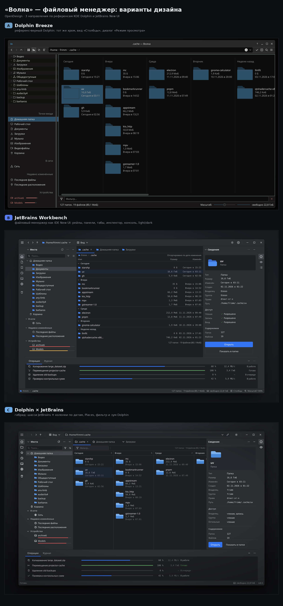

# «Волна» — файловый менеджер: дизайн и спецификация

Репозиторий дизайн-исследования файлового менеджера **«Волна»** (рабочее название): три варианта дизайна, измеренные референсы, implementation-grade спека выбранного направления и самодостаточные HTML-макеты.

**Статус:** дизайн-спецификация v1.0 (2026-11-13). Направление — **C: Dolphin × JetBrains**.
**Канонический макет:** [`design/artifacts/variant-c.html`](design/artifacts/variant-c.html) (открыть в браузере).



## Что внутри

| Путь | Содержимое |
|---|---|
| [`design/spec/`](design/spec/README.md) | **Спецификация**: продукт/направление, токены, компоновка, компоненты, взаимодействия, реализация, решения, приёмка |
| [`design/artifacts/`](design/artifacts/README.md) | Финальные макеты A/B/C (single-file HTML), C — канон |
| [`design/screens/`](design/screens/) | Скриншоты состояний и сравнение `compare.png` |
| [`design/reference/`](design/reference/) | Измеренные спеки референсов: Dolphin (398 строк) и JetBrains New UI (474 строки) |
| [`design/content-spec.md`](design/content-spec.md) | Единый контент экрана (данные, подписи, счётчики) |
| [`design/README.md`](design/README.md) | История дизайн-ревизий и краткое описание вариантов |
| [`design/runtime-fix.md`](design/runtime-fix.md) | Локальный фикс runtime OpenDesign (free tier) |
| [`reference/`](reference/) | Исходные скриншоты Dolphin от пользователя |

## Быстрый старт

```bash
# посмотреть канонический макет
cd design/artifacts && python3 -m http.server 8080
# http://localhost:8080/variant-c.html
# состояния: #view, #icons, #details, #ungrouped, #icons-ungrouped
```

Пересобрать скриншоты и коллаж:

```bash
design/tools/shot.sh "http://127.0.0.1:8080/variant-c.html" design/screens/variant-c.png 1600 1000
python3 design/tools/build_compare.py
```

## Спецификация в двух словах

- **Окно** 1440×900: тулбар 40, хедер-бэнд 40, рабочая область 608, нижняя панель 180, статус-бар 28.
- **Токены**: `#1e1f22`/`#2b2d30`/`#393b40`/`#3574f0`, Inter 13/12/11, JetBrains Mono для чисел; без градиентов/теней внутри окна.
- **Хром**: рейлы 40, левая панель 280, редактор 780, правая 300; табы 40 с 3px accent underline.
- **«Вид»** — единый поповер: режимы «Значки/Столбцы/Подробности», группировка, сортировка, скрытые файлы, плотность, масштаб.
- **Путь** — только в тулбаре, с кнопкой редактирования; статус-бар — только статус + `свободно 22,8 ГиБ · sdc1`.
- **Никаких дублей контролов и терминала**; все три режима — реальные.

Подробности — в [`design/spec/README.md`](design/spec/README.md).

## Лицензия и данные

Дизайн-материалы созданы для проекта «Волна». Источники шрифтов — системные (Inter/JetBrains Mono при наличии); внешние ассеты не используются. Демонстрационные данные взяты из референса Dolphin.
