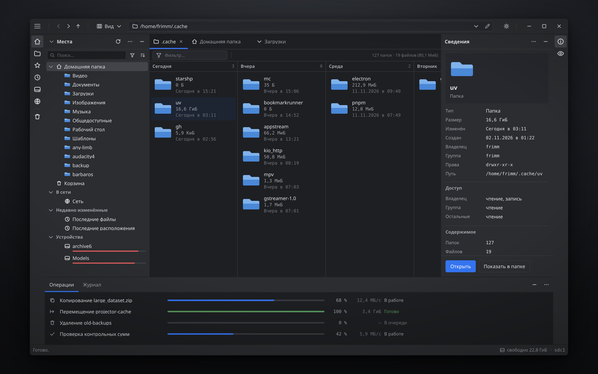

# «Волна» — файловый менеджер для Linux

«Волна» (рабочее название) — плотный файловый менеджер для Linux-десктопа: GTK4 + Python, без сборки C. Направление дизайна — **C (Dolphin × JetBrains)**: IDE-подобный ритм интерфейса, вкладки каталогов и единая панель «Вид».

> **Статус: ранняя стадия развития.** Приложение запускается и показывает каталоги, но это ещё не файловый менеджер: операции над файлами, поиск, режимы «Значки»/«Столбцы» и инспектор не реализованы. Задуманный вид — в разделе [дизайна](design/README.md).



*На рисунке — дизайн-макет, а не текущий интерфейс приложения.*

## Что работает сегодня

- **Вкладки каталогов.** Новая вкладка (☰ → «Новая вкладка», `Ctrl+T`) открывается в каталоге активной вкладки, закрывается крестиком или `Ctrl+W`; последнюю вкладку закрыть нельзя. У каждой вкладки свои листинг, позиция прокрутки, история переходов и настройки отображения; новая вкладка наследует настройки активной.
- **Навигация.** Двойной клик по папке открывает её, «Назад»/«Вперёд» ходят по истории вкладки, «Вверх» открывает родительский каталог. Виджет пути в тулбаре: клик открывает список известных мест, карандаш — inline-редактирование (`Enter` — перейти, `Esc` или потеря фокуса — отмена; относительный путь считается от каталога активной вкладки; несуществующий путь оставляет прежний, подсвечивает виджет красным и пишет «Путь недоступен» в статус-бар).
- **Три режима просмотра.** «Подробности» — таблица «Имя / Размер / Дата» с глифом типа слева от имени; «Столбцы» — горизонтальные колонки; «Значки» — сетка плиток. Сканирование идёт в рабочем потоке, батчи приходят в модель через `GLib.idle_add`, статус и счётчики живые.
- **Группировка.** Листинг делится на группы `Сегодня / Вчера / <день недели> / Неделю назад` по дате изменения или на полосы `Папки / 0 Б / до 10 КиБ / … / больше 1 ГиБ / Без размера` по размеру — с заголовком и счётчиком во всех трёх режимах; «Без группировки» — плоский список/сетка/безголовые колонки. Папки при группировке по размеру всегда идут отдельной группой: их `st_size` — размер inode, а не содержимого. Пороги полос — таблица данных `SizeGrouping.BANDS` в `display/grouping.py`. Сортировка действует внутри групп. Выбор — в панели «Вид» и живёт в настройках вкладки.
- **Сворачивание групп.** В «Подробностях» и «Значках» заголовок группы сворачивает её содержимое; повторный клик, шеврон или контекстное меню («Свернуть остальные», «Свернуть все», «Развернуть все») возвращают его. Состояние живёт на вкладке до конца сеанса и сбрасывается при навигации; в «Столбцах» сворачивания нет.
- **Панель «Вид».** Поповер в тулбаре слева от пути: режим просмотра, группировка, сортировка (ключ, направление, «папки перед файлами»), показ скрытых файлов, плотная раскладка. Изменения применяются сразу к активной вкладке, без пересканирования. Скрытые файлы по умолчанию скрыты.
- **Пресеты вида.** Секция «Пресеты» в панели «Вид»: четыре встроенных (`По умолчанию`, `Плотный список`, `Крупные значки`, `Без группировки`) и пользовательские снапшоты всех настроек отображения. Пресет применяется к активной вкладке; сохранение, переименование и удаление — диалогами, которые открываются из строки списка (у встроенных пресетов действий нет; переименование неактивно при пустом или неизменённом имени). Подпись поля показывает пресет, чьему снапшоту соответствует текущий вид, иначе — «Настроено вручную».
- **Сохранение настроек.** Последний вид активной вкладки сохраняется при закрытии окна в `$XDG_CONFIG_HOME/volna/settings.json`, пользовательские пресеты — в `presets.json` того же каталога. Битый или read-only конфиг не мешает запуску: приложение стартует на значениях по умолчанию (пресеты остаются в памяти до конца сессии).
- **Окно.** Без системных декораций: перетаскивается за шапку, ресайзится за края и углы. Масштаб интерфейса следует системному UI-кеглю: на 100 %-десктопе — компактная сетка (хром 40 px, окно 1440×900, минимум 1125×750), на 125 % — широкий пресет (хром 50 px, окно 1800×1125). Семейство и кегль шрифта наследуются от системы.

## Чего ещё нет

Копирование, переименование, перемещение и удаление; поиск и фильтр по имени; масштаб; инспектор «Сведения» и содержимое нижней панели «Операции/Журнал»; ручной выбор размера интерфейса (масштаб уже следует за системным, оверрайд — в настройках). Рейлы, дерево «Места» и нижняя панель пока — заглушки дизайна. Очередь работ и принятые решения — в [design/view-panel.md](design/view-panel.md) и [design/grouping.md](design/grouping.md).

## Требования

Linux (X11 или Wayland), GTK 4, Python ≥ 3.11, [`uv`](https://docs.astral.sh/uv/).

## Установка и запуск

```bash
uv sync
uv run invoke venv    # окружение с системными пакетами: PyGObject ставится из системы
uv run invoke deps    # gir1.2-gtk-4.0 + gir1.2-graphene-1.0 (нужен sudo)
uv run volna          # главное окно
```

Снимок окна в PNG (нужен запущенный дисплей):

```bash
uv run volna --screenshot .tmp/volna.png
```

## Разработка

```bash
uv run pytest       # тесты: 4 worker-а pytest-xdist, module-scoped
uv run pytest -n0   # последовательно: отладка или одиночный тест
uv run ruff check   # линт
uv run ruff format  # форматирование
uv run mypy         # проверка типов (strict, см. [tool.mypy])
```

`pytest` по умолчанию идёт в четырёх worker-ах (`-n 4 --dist loadscope`): каждый worker
поднимает свой Xvfb, а `loadscope` держит модуль в одном worker-е — с дефолтным
`--dist load` полный прогон зависает. `-n 8` быстрее не делает, `-n auto` на этой машине
зависает; при нехватке CPU/памяти уменьшайте `-n`. `-n0` отключает xdist.

То же через `invoke`: `uv run invoke testing`, `uv run invoke check`, `uv run invoke fmt`,
`uv run invoke types`. Гейт целиком — `uv run invoke static` (линт, формат, типы) и
`uv run invoke verify` (то же плюс тесты).

### Git-хуки

CI нет, поэтому гейт живёт в хуках, которые лежат в репозитории (`.githooks/`):
до коммита — `invoke static`, до пуша — `invoke verify`. Включаются один раз в каждом
клоне:

```bash
uv run invoke hooks
```

Отдельный коммит можно провести мимо хуков через `git commit --no-verify`; отключить
обратно — `git config --unset core.hooksPath`.

## Структура репозитория

| Путь | Назначение |
|---|---|
| `src/volna/main.py` | точка входа: приложение GTK4, тема, сохранение настроек |
| `src/volna/window.py` | окно: тулбар, вкладки, рабочая область, статус-бар |
| `src/volna/tab.py` | вкладка каталога: модель + контроллер + вид + история |
| `src/volna/controller.py` | асинхронная связка сканера и модели (поток → `GLib.idle_add`) |
| `src/volna/core/` | перечисление каталогов, сортировка, модель листинга — без GTK |
| `src/volna/display/` | настройки отображения, стратегии группировки и их хранение — без GTK |
| `src/volna/view_panel/` | панель «Вид»: поповер, feature-модули настроек, секция и диалоги пресетов |
| `src/volna/views/` | GTK-режимы «Подробности»/«Столбцы»/«Значки», заголовки групп и форматирование значений |
| `src/volna/history.py`, `naming.py`, `geometry.py`, `size.py`, `glyph.py` | история навигации, имена и иконки, хит-тест краёв окна, масштаб интерфейса, локальные SVG-глифы |
| `tests/` | системные и юнит-тесты |
| `design/` | дизайн: макеты, спека, референсы |
| `reference/` | исходные скриншоты Dolphin, предоставленные пользователем |

## Документация

- [design/README.md](design/README.md) — раздел дизайна: варианты, спека, макеты, референсы.
- [design/spec/README.md](design/spec/README.md) — implementation-grade спека направления C.
- [design/view-panel.md](design/view-panel.md) — проект и реализация панели «Вид».
- [design/view-modes.md](design/view-modes.md) — проект режимов просмотра: «Подробности», «Столбцы», «Значки».
- [design/grouping.md](design/grouping.md) — проект и реализация группировки по дате изменения.
- [AGENTS.md](AGENTS.md) — правила работы над проектом.

## Лицензия

MIT — см. [LICENSE](LICENSE).
