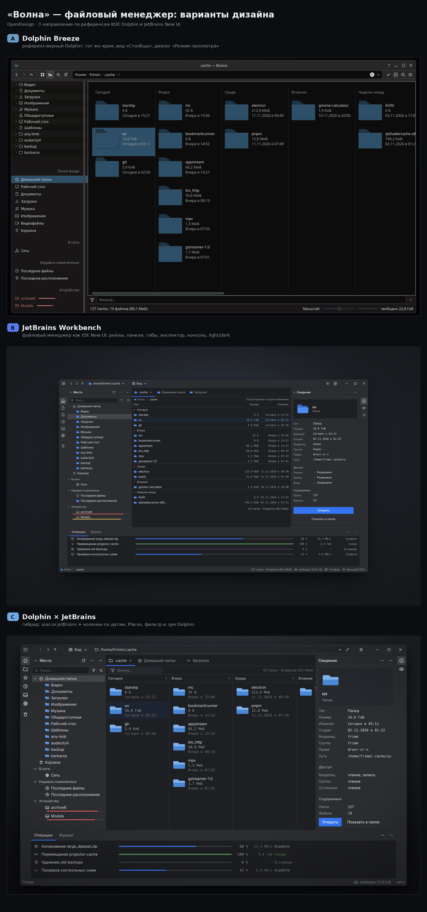

# «Волна» — дизайн

Раздел дизайна файлового менеджера «Волна»: три варианта направления, измеренные референсы, implementation-grade спека выбранного варианта и самодостаточные HTML-макеты.

**Статус:** спецификация v1.5 (2026-11-15), направление — **C: Dolphin × JetBrains**.
**Канонический макет:** [`design/artifacts/variant-c.html`](artifacts/variant-c.html) — открыть в браузере.



## Что внутри

| Путь | Содержимое |
|---|---|
| [`spec/`](spec/README.md) | **Спецификация** направления C: продукт, токены, компоновка, компоненты, взаимодействия, реализация, решения, приёмка |
| [`artifacts/`](artifacts/README.md) | Финальные макеты A/B/C (single-file HTML), C — канон |
| [`screens/`](screens/) | Скриншоты состояний и сравнение `compare.png` |
| [`reference/`](reference/) | Измеренные спеки референсов: Dolphin (398 строк) и JetBrains New UI (474 строки) |
| [`content-spec.md`](content-spec.md) | Единый контент экрана (данные, подписи, счётчики) |
| [`view-panel.md`](view-panel.md) | Проект и реализация панели «Вид»: решения, API, хранение, тесты, отложенное |
| [`view-modes.md`](view-modes.md) | Проект и реализация режимов просмотра: «Значки», «Столбцы», «Подробности» |
| [`grouping.md`](grouping.md) | Проект и реализация группировки листинга по дате изменения |
| [`tools/`](tools/) | Скриншоты (`shot.sh`) и сравнительный коллаж (`build_compare.py`) |
| [`backups/`](backups/) | Предыдущие версии макетов |
| [`runtime-fix.md`](runtime-fix.md) | Локальный фикс runtime OpenDesign (free tier) |
| [`../reference/`](../reference/) | Исходные скриншоты Dolphin от пользователя |

## Быстрый старт

```bash
# посмотреть канонический макет
cd design/artifacts && python3 -m http.server 8080
# http://localhost:8080/variant-c.html
# состояния: #view, #presets, #presets-save, #icons, #details, #ungrouped, #icons-ungrouped
# размер интерфейса: по умолчанию широкий; ?size=compact — компактный
```

Пересобрать скриншоты и коллаж (окно 1920×1200 при масштабе 2 — PNG 3840×2400):

```bash
design/tools/shot.sh "http://127.0.0.1:8080/variant-a.html" design/screens/variant-a.png 1920 1200
design/tools/shot.sh "http://127.0.0.1:8080/variant-b.html" design/screens/variant-b.png 1920 1200
design/tools/shot.sh "http://127.0.0.1:8080/variant-c.html" design/screens/variant-c.png 1920 1200
python3 design/tools/build_compare.py
```

---

## Варианты

Три варианта дизайна файлового менеджера «Волна» (рабочее название), подготовленные в OpenDesign по двум референсам:

1. **KDE Dolphin** — конкретный экран из `reference/`: тёмная Breeze-тема, русская локаль, вид **«Столбцы»** с группировкой по дате изменения, 3-строчные ячейки (иконка + имя/размер/дата), двухпанельный сайдбар Places, нижняя полоса фильтра и статуса с зумом.
2. **JetBrains New UI** (PyCharm/IntelliJ 2023–2025) — язык панелей: 40 px хром, непрерывная полоса заголовков + табы, вертикальные рейлы tool window, инспектор, нижняя панель, статус-бар, плотные 24 px строки, плоская двухтоновая тёмная тема.

Общий контент экрана у всех вариантов одинаковый (папка `.cache`, 5 групп дат, 14 объектов, счётчики `127 папок · 19 файлов (80,1 МиБ)`, `свободно 22,8 ГиБ`) — чтобы сравнивать именно дизайн, а не наполнение.

| Вариант | Проект OpenDesign | Скриншот | Направление |
|---|---|---|---|
| **A — Dolphin Breeze** | `volna-a-dolphin-breeze` | [`screens/variant-a.png`](screens/variant-a.png) | Максимально верное воспроизведение референса Dolphin: тот же хром, тот же вид «Столбцы», диалог «Режим просмотра» |
| **B — JetBrains Workbench** | `volna-b-jetbrains-workbench` | [`screens/variant-b.png`](screens/variant-b.png) | Файловый менеджер, спроектированный как IDE JetBrains: рейлы, панели, табы, инспектор, панель операций, light/dark темы, единое окно «Вид» |
| **C — Dolphin × JetBrains** | `volna-c-hybrid` | [`screens/variant-c.png`](screens/variant-c.png) | Гибрид: шасси JetBrains New UI + фирменный контент Dolphin; все три режима просмотра (Значки / Столбцы / Подробности), группировка, единое окно «Вид» с масштабом |

**Ревизия 2 (по фидбеку):** в вариантах **B** и **C** убраны дублирующиеся контролы (одна настройка, одна тема, один поиск/фильтр, один контрол вида), полностью удалён терминал (нижняя панель теперь только «Операции / Журнал», в рейлах нет кнопок терминала), дерево Places очищено от повторяющихся строк, а вместо контрола «Столбцы» появилось **всплывающее окно «Вид»** с настройками отображения: режим просмотра, сортировка (ключ + направление), показ скрытых файлов и плотная раскладка. Вариант **A** не менялся.

**Ревизия 3 (вариант C, по фидбеку):** кнопка «Вид» перенесена влево от пути (фиксированная позиция, не «прыгает» при разной длине пути); путь остался только в тулбаре, добавлена кнопка редактирования пути (переход по введённому адресу); в окне «Вид» появились **все три режима просмотра** (Значки / Столбцы / Подробности) и секция **«Группировка»** (по дате / без группировки); ползунок **«Масштаб»** переехал из статус-бара в «Вид»; в статус-баре слева теперь только статус («Сканирование…» / «Готово.»), справа — `свободно 22,8 ГиБ · sdc1` (имя устройства рядом со свободным местом).

**Ревизия 4 (вариант C):** в «Вид» добавлена секция **«Пресеты»** — выбор готового пресета (4 встроенных) и кнопка сохранения; по кнопке открывается диалог «Сохранить пресет» с полем имени, списком существующих пресетов, подсказкой о перезаписи и кнопками «Отмена/Сохранить». Ручные изменения показывают «Настроено вручную»; пользовательские пресеты сохраняются в `localStorage` и перекрывают встроенные по имени.

**Ревизия 5 (вариант C):** в списке пресетов появились действия для пользовательских пресетов — **переименование** (inline-input, Enter/Esc) и **удаление** (диалог подтверждения, fallback на «По умолчанию» при удалении текущего). Встроенные пресеты неизменяемы; действия появляются на hover/фокусе и доступны с клавиатуры.

**Ревизия 6 (типографика):** шкала увеличена на 1px — UI 13 → 14px, secondary/meta 12 → 13px, caption 11 → 12px, имя элемента 12.5 → 13.5px, заголовок карточки 16 → 17px; «Столбцы» выросли с 62 до 66px, чтобы 3-строчная ячейка не обрезалась. Размеры вынесены в CSS-переменные `--fs-*` в `:root`, чтобы следующая ревизия менялась в одном месте.

**Ревизия 7 (размер интерфейса):** два пресета размера. **Широкий — по умолчанию**: UI 125 %, окно 1800×1125 (ориентир — PyCharm UI при 125 %). **Компактный** — опция: UI 100 %, окно 1440×900, в макете включается `?size=compact`. Плотная раскладка (`is-compact`) остаётся независимой осью.

**Ревизия 8 (продукт, масштаб):** в приложении дефолт больше не «широкий», а **системный**: масштаб считается от UI-кегля рабочего стола (100 % → компактная сетка, 125 % → широкий пресет), шрифт наследуется от системы; см. [spec/07 D27](spec/07-decisions.md). Макет остаётся двухпресетным референсом — он не следует за рабочим столом.

## Как открыть

Проекты созданы в локальном OpenDesign (daemon `127.0.0.1:7457`). В превью:

- **A** — <http://127.0.0.1:7457/api/projects/volna-a-dolphin-breeze/raw/index.html>
- **B** — <http://127.0.0.1:7457/api/projects/volna-b-jetbrains-workbench/raw/index.html>
- **C** — <http://127.0.0.1:7457/api/projects/volna-c-hybrid/raw/index.html>

Каждый проект — самостоятельный `index.html` (inline CSS/JS/SVG, без внешних зависимостей), окно 1440×900 автоматически масштабируется под вьюпорт. Открыть в OpenDesign Studio и посмотреть живьём можно из списка проектов.

## Что можно потыкать

- **A:** активная кнопка «Столбцы» открывает диалог «Режим просмотра» (OK/Отмена/Esc, чекбоксы, disabled «Применить»); фильтр внизу живой; ползунок «Масштаб» меняет размер ячеек; горизонтальный скролл колонок; selection/hover.
- **B:** кнопка «Вид» открывает всплывающее окно настроек отображения (режим, сортировка + направление, скрытые файлы, плотная раскладка); переключатель тёмной/светлой темы (Light = тёмный тулбар + светлые панели, как в JetBrains); 3 вкладки локаций; выбор строки обновляет «Сведения»; нижние вкладки «Операции/Журнал». Deep-link `#view` открывает окно «Вид» сразу.
- **C:** по умолчанию открывается широкий пресет размера интерфейса (UI 125 %, окно 1800×1125); `?size=compact` включает компактный (UI 100 %, окно 1440×900; можно совмещать с `#view`, `#details`, …). Кнопка «Вид» (слева от пути, позиция фиксирована) открывает окно настроек: **пресеты** (выбор + сохранение с диалогом имени), **все три режима просмотра** (Значки / Столбцы / Подробности), **группировка** (по дате / без), сортировка + направление, скрытые файлы, плотная раскладка и **масштаб**; путь редактируется кнопкой-карандашом (переход по адресу); живой фильтр; клик по объекту обновляет «Сведения»; в статус-баре слева — только статус («Сканирование…» / «Готово.»), справа — `свободно 22,8 ГиБ · sdc1`; вкладки и нижняя панель «Операции/Журнал». Deep-link для QA: `#view`, `#presets`, `#presets-save`, `#icons`, `#details`, `#ungrouped`.

## Зачем каждый вариант и что он проверяет

- **A — база верности.** Показывает, что именно даёт референс Dolphin: ощущение «настоящего» файлового менеджера, плотность, низкохромная тёмная тема, характерная трёхстрочная ячейка. Плюс: узнаваемость и доверие у Linux-пользователей. Минус: выглядит как ещё один Dolphin, мало собственного лица; панели не масштабируются на «профессиональный инструмент».
- **B — язык JetBrains.** Показывает, как выглядит файловый менеджер, спроектированный по грамматике IDE: 40 px ритм, непрерывная полоса заголовков, рейлы, инспектор, панель операций, настройки вида в одном поповере. Плюс: техническая солидность, плотность, панельная расширяемость, готовая светлая тема. Минус: IDE-метафоры могут давить на новичков; вид «Столбцы» из референса теряется (заменён списком).
- **C — рекомендуемое направление.** Сохраняет информацию и характер Dolphin (колонки по датам, Places, фильтр, зум, папки) и получает дисциплину, плотность и расширяемость JetBrains (рейлы, инспектор, нижняя консоль, статус-бар). Это лучший кандидат в продуктовый дизайн: файловый менеджер читается как инструмент, а не как «ещё один проводник».

**Рекомендация:** развивать **C**, держа **B** как источник панельных паттернов и light-темы, а **A** — как эталон верности референсу/для консервативных пользователей KDE.

## Дизайн-токены (сводка)

- **A:** фон `#181616`, хром `#282727`, view `#0d0c0c`, текст `#d9dcd9/#a1a49f`, папки `#1e3545/#2d4f67`, акцент-сталь `#455661/#2d4f67`, salmon `#c4746e`; шрифт Noto Sans 13 px/18 px, без жирного; строки 22/26/101 px.
- **B/C:** canvas `#1e1f22`, chrome `#2b2d30`, hairline `#393b40`, текст `#dfe1e5/#9da0a8`, accent `#3574f0`, selection `#43454a` / focused `#1d2432`, folder blue `#4a88d8`; Inter (B — 13 px, C — 14/13/12 px), моно JetBrains Mono; хром 40 px, строки 24 px, радиусы 4 px, без градиентов/теней внутри окна.

## Сравнительный коллаж

[`screens/compare.png`](screens/compare.png) — все три варианта в одной картинке с подписями (A / B / C).

## Референсы и спеки

- `reference/` — исходные скриншоты Dolphin (вид «Столбцы» с группировкой по дате, сортировка по размеру, диалог «Режим просмотра»).
- `design/content-spec.md` — общий контент экрана (данные, подписи, счётчики).
- `design/reference/dolphin-spec.md` — измеренная спека Dolphin (398 строк: геометрия, палитра, типографика, инвентарь).
- `design/reference/jetbrains-spec.md` — спека JetBrains New UI (474 строки: панельная анатомия, палитры dark/light, метрики, do/don't, источники).
- `design/briefs` — брифы вариантов (DESIGN.md лежит в корне каждого проекта OpenDesign).
- `design/screens/` — финальные скриншоты (`variant-a/b/c.png`, состояния `variant-b-view.png`, `variant-c-view.png`, `variant-c-presets.png`, `variant-c-presets-actions.png`, `variant-c-preset-rename.png`, `variant-c-preset-save.png`, `variant-c-preset-delete.png`, `variant-c-icons.png`, `variant-c-details.png`, `variant-c-ungrouped.png`, компактный пресет `variant-c-compact.png`) и сравнительный коллаж `compare.png`.

> «Волна» — рабочее название; заголовок окна и строки локализации легко заменить. Данные (имена папок, размеры, даты) взяты из референса, чтобы все три варианта были сравнимы 1:1.
